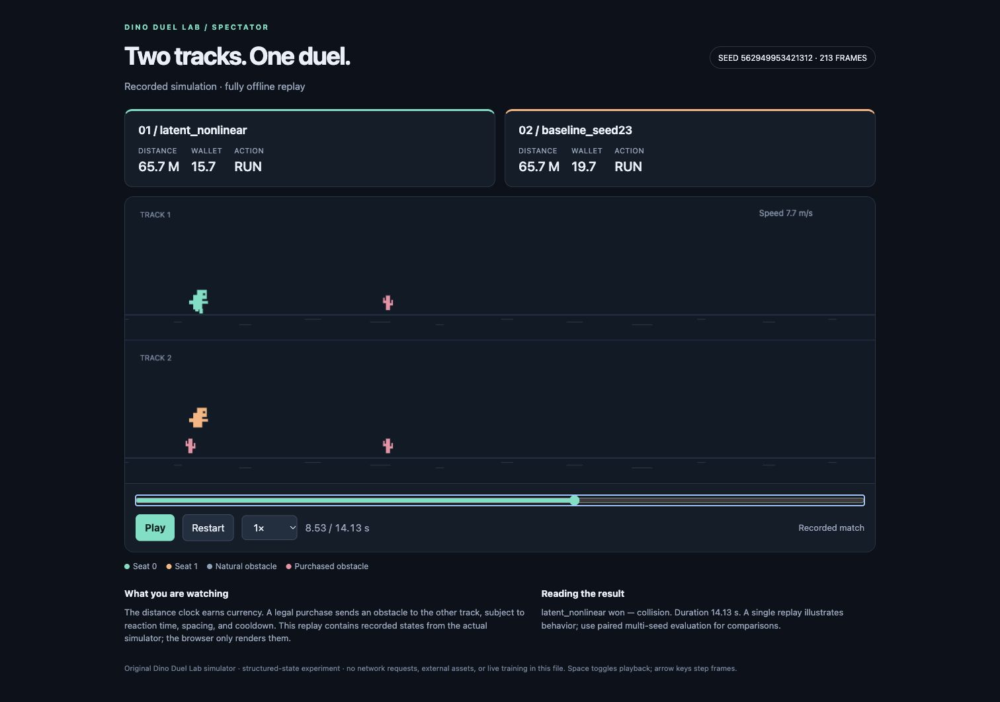

# Dino Duel Lab

An adversarial two-player dinosaur running game and reproducible reinforcement
learning sandbox. Players run, jump and duck on separate tracks, earn currency,
and buy obstacles for their opponent. The research code compares PPO,
JEPA-style multi-horizon prediction, and counterfactual attack-macro selectors.



The screenshot shows a frame of the shipped recorded simulation. Open
[`examples/planning_replay.html`](examples/planning_replay.html) locally for
Play, timeline seeking and playback speed controls. The browser renders saved
states; it does not train or run a neural policy.

This is an AI-assisted research prototype recovered from the project's ChatGPT
cloud conversation. This repository retains its actual source, tests, small
inference models and selected historical evidence. It is not a DINO computer
vision model or an official Meta JEPA implementation.

## What is implemented

- A deterministic, headless NumPy duel environment with action masks, currency,
  cooldowns, obstacle geometry, snapshot/restore and reachability checks.
- A trained shared running skill, PPO self-play, paired seats/seeds, resumable
  learning, and a trainable defensive correction head.
- An optional EMA target encoder and action-conditioned latent prediction at
  8, 32 and 64 control steps. The main policy uses 53 public structured
  observation features; it does not consume pixels or future labels at inference.
- Counterfactual branches with opponent reactions, frozen-controller macro
  selectors, explicit deployment abstention, and separate offline/online analyses.
- Self-contained HTML replays and reports, uncertainty grouped by the actual
  experimental unit, and explicit handling of unresolved elimination games.

## Run a small demo

Python 3.11–3.13 is supported. A scripted duel and the trained NumPy running
skill need only the core NumPy dependency:

```bash
python -m venv .venv
source .venv/bin/activate
python -m pip install -e .
python run.py demo --seconds 10 --out runs/demo/replay.html
```

Open the generated HTML in a browser. This command simulates a small example;
it does not retrain the agents or reproduce the research evaluations.

To use the six included trained PPO inference checkpoints or run the test suite:

```bash
python -m pip install -e ".[train,test]"
python -m pytest -q
python run.py replay --config configs/elimination.json \
  --left elimination/runs/jepa_seed11/policy.pt \
  --right elimination/runs/baseline_seed11/policy.pt \
  --use-checkpoint-env --sampling-mode joint --seconds 10 \
  --out runs/trained-demo/replay.html
```

The ten-second replay is a bounded demonstration and may finish unresolved.
An external observation budget is not a game draw or a terminal reward.

## Publication verification

The curated export was checked on 26 October 2026 in a fresh isolated environment
with Python 3.12.14, NumPy 2.3.5 and PyTorch 2.10.0. All **120 tests passed**, with
zero skips. Both quickstart commands completed and generated 151-frame,
ten-second replays. The trained-policy example correctly recorded an unresolved
match when its external observation budget expired. These checks exercise the
published implementation; the historical research experiments were not rerun.
See [PUBLICATION_VALIDATION.json](PUBLICATION_VALIDATION.json).

## Explore the recorded study

- [`paired_advantage/report.html`](paired_advantage/report.html): the latest
  paired-advantage selector study, with embedded evidence and replay content.
- [`paired_advantage/RESULTS.md`](paired_advantage/RESULTS.md): historical
  execution scope, scores and limitations in plain text.
- [`counterfactual/report.html`](counterfactual/report.html): the earlier
  frozen-policy counterfactual planning extension.
- [`elimination/RESULTS.md`](elimination/RESULTS.md): the earlier PPO versus
  JEPA-assisted PPO elimination comparison and its uncertainty.
- [`examples/planning_replay_selection.json`](examples/planning_replay_selection.json):
  the recorded replay selection rule and provenance.

These are preserved results from the earlier assistant-run CPU experiments,
not training or evaluation rerun during portfolio preparation. The latest
extension fits small selectors using frozen earlier policies/representations;
it does not train a new full JEPA-PPO agent.

For example, the historical raw latent-auxiliary selector recorded 46 wins,
10 losses and 8 unresolved games across 64 fixed evaluation cases; the frozen
PPO reference recorded 42/8/14 on those cases. Each method faced the same four
fixed opponents across eight environment seeds and both seats. These counts
are not a direct head-to-head match between the two methods, and do not
establish a stable JEPA benefit. The neural validation gates rejected deployment
switching; raw selector results are diagnostic. See the full report for the
grouped uncertainty and negative results.

## Scope of this export

The repository includes all ten test modules, core and research source,
configuration presets, tiny NumPy runner assets, and six inference-only
`policy.pt` files. Their combined policy size is about 1.5 MB; they contain no
optimizer state. Large branch datasets, optimizer/resume checkpoints, raw
training logs, intermediate checkpoints, counterfactual/paired-selector weights
and the diagnostic tree pickle are
omitted. Scripts that need those omitted research artifacts require the full
recovery bundle; this clone alone does not reproduce all historical experiments.
The six policies support plain-agent replays. Regenerating the recorded planned
match also requires selector weights from the full recovery bundle.

[`RECOVERY_PROVENANCE.json`](RECOVERY_PROVENANCE.json) records the recovered
source paths and SHA256 hashes of copied files. The original full-archive
instructions are retained as
[`docs/RECOVERED_ARCHIVE_README.md`](docs/RECOVERED_ARCHIVE_README.md); their
full-dataset/training commands describe that original archive.

The project is MIT licensed. See [`LICENSE`](LICENSE) and
[`docs/THIRD_PARTY.md`](docs/THIRD_PARTY.md) for provenance and attribution.
No Chrome Dino source code, sprites or third-party pretrained weights are
included. The optional original-game adapter is separate from the main duel
environment and requires an explicit fetch.
